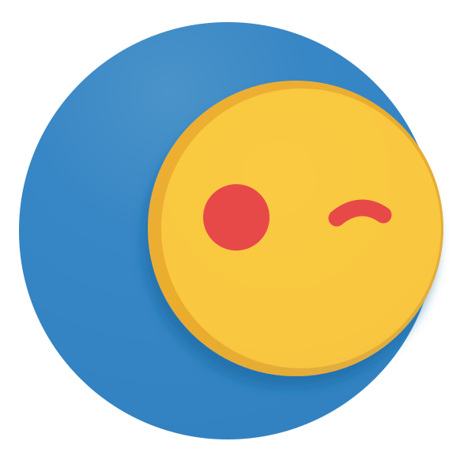

<p align="center">

  
</p>

<h1 align="center">OSCAR</h1>

<p align="center"><strong>A persistent, multimodal, agentic personal intelligence spanning phone, computers, communications, environment and physical hardware.</strong></p>

<p align="center"><code>Persistent</code> · <code>Context-aware</code> · <code>Agentic</code> · <code>Immediate</code> · <code>Learning</code> · <code>Evidence-backed</code></p>

---

## Current development and milestones

**Group 3 — 2026-10-16:** the owner authorizes unattended backend engineering
through Slices 14–17 from merged Mobile main `257349f`. The first scoped Slice 14
candidate adds World Model/Perception/Sentry headless behavior and tests; full
Gate D and separate Gate C acceptance remain **PARTIAL**. Approved UI is preserved.
See [implementation, measurements and continuation](docs/development/GROUP-03-GATE-D.md).

**Current status — 2026-10-14:** OSCAR Desktop Group 2.5A was **provisionally approved by the owner** (restrained neumorphic Companion + Workspace) and [PR #5](https://github.com/Amaan27-Buzz/oscar/pull/5) merged to `main` at `43c15d37a6421d438b8101d5e322489ae452b20d`. Earlier stacked software Groups 1–2 are likewise incorporated into `main`. The tiny Companion preserves the unchanged Orb and stays separate from the full Workspace. The current Workspace includes Conversation, Automations, Activity, Devices and Preferences. Automations does **not** yet mean persistent Workers/schedules are running.

**Current focus — Group 2.5B / Slice 13:** the owner **APPROVED Mobile UI/UX on 2026-10-16**, including all 15 heroes, integrated artwork, native controls, Preferences, navigation, motion and the canonical Orb. [Final engineering closure](docs/ui/mobile/group25b/FINAL-CLOSURE.md) preserves that design and the Core, Grid, signing, voice and Expression boundaries. The external Gemini Argon `oscar-ui-test` prototype remains rejected. UI approval is separate from physical commissioning and remote CI.

**Future:** [Adaptive Interface Engine](docs/ADAPTIVE-INTERFACE.md) is planned for typed, interactive responses in the *same conversation* (Slice 16 presentation protocol, 17 composition, 19 hardening, 20 integrated validation); not built. Sentry remains Slice 14. Full Access authority and persistent Workers require their actual Core security/execution integrations. See [active product direction](docs/PRODUCT-DIRECTION.md) and [canonical slices 00–20](docs/SLICE-NUMBERING.md).

**Acceptance:** Gate A and local-alpha Gate B are accepted for documented scope. Mobile Group 2.5B UI/UX is owner-approved; the Desktop design pass remains interim. Gate C, physical commissioning, voice, biometric/security acceptance and remote CI are separate and are not silently passed. Older reference screenshots, candidate PRs and historical reports remain in Git history and the dated evidence folders.

## What OSCAR is

OSCAR is a practical interpretation of the idea behind JARVIS: one intelligence that can perceive current context, reason, communicate, use tools, delegate work, operate software/hardware, keep working in the background, coordinate the user's day and appear through whichever trusted device is available.

It is **not** a conventional chat app, a laptop-only agent, a wrapper around one model provider or a decorative orb.

OSCAR's truth rule:

> **Know what you know, know why you know it, verify what can be verified, and never claim more than the evidence supports.**

Tool, Worker, model or API success is evidence, not automatic proof that the objective is complete.

## One relationship, one interaction point

OSCAR is designed as one continuous relationship rather than a collection of disconnected chats.

```text
You ↔ OSCAR
```

Text, voice, OSCAR Mobile, desktop, communications, Workers and Edge all contribute to the same continuity where policy permits. Internally OSCAR segments events, episodes, objectives, entities and memories for retrieval and scaling, but the user should not have to find an old chat to recover context.

The canonical history belongs to OSCAR. Managed memory vendors are optional, never required infrastructure.

See [`docs/MEMORY.md`](docs/MEMORY.md).

## OSCAR Memory Fabric

The long-term memory architecture is self-hostable and vendor-independent:

```text
Active Context
      ↓
OSCAR Event Archive
SQLite + WAL + FTS5
canonical history/provenance
      ↓
Memory Formation
  ┌───┴──────────────┐
  ↓                  ↓
Qdrant OSS       Graphiti OSS
hybrid semantic  temporal/entity
retrieval        relationships
                     ↓
               Neo4j Community
  └──────┬───────────┘
         ↓
Retrieval Fusion + reranker
         ↓
Controller Memory Preflight
         ↓
Context Assembly
         ↓
Reason / Act
         ↓
Claim Verification
```

Key rules:

- the Event Archive is canonical; Qdrant/Graphiti are rebuildable indexes;
- Controller decides when recall is mandatory before reasoning;
- personal/historical claims require source event/memory evidence;
- an empty retrieval is not proof that the memory never existed;
- live authoritative state outranks stale recall;
- corrections supersede previous facts temporally instead of silently rewriting history;
- inference never silently becomes fact;
- OSCAR never says `I remember X` unless X was actually retrieved or remains in active context with provenance.

The previous planned Supermemory dependency has been retired.

## Ambient Chief of Staff

OSCAR should be continuously available and quietly useful. With explicit permission, current context can include:

```text
time / date / timezone
weather
calendar + free/busy
tasks / deadlines / dependencies
location / mobility
notifications + communications
media / activity / focus signals
device + Connection Grid state
Workers / Protocols
Sentry / Edge observations
```

The goal is not to dump context back to the user. OSCAR should combine it into useful decisions: protect focus time, detect schedule conflicts, manage flexible blocks, surface changed commitments, account for travel/weather, summarize what was missed and update tasks/calendar when policy allows.

Proactivity is graduated:

```text
observe silently
→ inform
→ suggest
→ act within policy
→ interrupt only when justified
```

A core privacy/authority rule is:

```text
CAN PERCEIVE ≠ CAN RETAIN ≠ CAN ACT
```

See [`docs/CHIEF-OF-STAFF.md`](docs/CHIEF-OF-STAFF.md).

## One intelligence, one Connection Grid

```text
                         OSCAR
                           │
        ┌──────────────────┼──────────────────┐
        ▼                  ▼                  ▼
      OSCAR Mobile            Cloud             Desktop(s)
 owner control       rendezvous/state      high compute
        │                                     │
        └──────────────────┬──────────────────┘
                           ▼
                       OSCAR Edge
                  local reflex / safety
```

- **OSCAR Mobile** — OSCAR on the phone; preferred owner-control, approval, notification and Chief-of-Staff surface.
- **Cloud** — replaceable rendezvous/durable coordination.
- **Desktop** — optional high-capability execution: coding agents, terminal, filesystem, browser/computer use, installed apps, GPU/local models.
- **Edge** — persistent local wake, sensors, GPIO, reflexes and deterministic safety.

No ordinary laptop/desktop is OSCAR's permanent host. Losing one node should reduce capability rather than erase OSCAR.

See [`docs/CONNECTION-GRID.md`](docs/CONNECTION-GRID.md).

## OSCAR Mobile — phone embodiment

OSCAR Mobile should feel **present, not launched**.

On Android, the product direction is to use legitimate platform capabilities where supported and explicitly granted:

- selected assistant/voice-interaction role;
- optional OSCAR Orb overlay;
- attention-aware Orb retreat during video, reading, presentation or focus contexts;
- edge/hotspot/assistant/voice invocation and natural reappearance;
- configurable home-screen widgets;
- notification-listener context;
- legitimate notification reply actions when exposed;
- biometric/PIN confirmation for sensitive owner actions.

Notification visibility is not unrestricted source-app access. OEM/device behavior remains unverified until tested on target hardware.

See [`docs/MOBILE-DESIGN.md`](docs/MOBILE-DESIGN.md), [`docs/SURFACES.md`](docs/SURFACES.md) and [`docs/CHIEF-OF-STAFF.md`](docs/CHIEF-OF-STAFF.md).

## Native infrastructure

OSCAR does not require the separate Latch or SwitchRoute projects as runtime products.

```text
Latch ideas/logic       → native OSCAR Transport + Capability Fabric
SwitchRoute ideas/logic → native OSCAR Model Router
```

OSCAR owns the Decision / Epistemic Controller (Controller in these docs). Its
current `oscar/jev.py` name is historical/internal; no TypeSafe Jev runtime/API is
required. The Controller decides whether OSCAR should execute, retrieve, verify, reason, delegate or ask. Capability selection chooses the executor. The Model Router chooses a provider/model only after a model path is selected.

Freshness-sensitive questions use current authoritative evidence when reasonably available. Provider manifests and memory are not permanent truth.

See [`docs/NATIVE-INFRASTRUCTURE.md`](docs/NATIVE-INFRASTRUCTURE.md), [`docs/MODEL-ROUTING.md`](docs/MODEL-ROUTING.md) and [`docs/SEARCH-FRESHNESS.md`](docs/SEARCH-FRESHNESS.md).

## System at a glance

```text
User / Environment
      ↓
Perception Fabric → World Model
      ↓
Controller
      ├─ current/live retrieval
      ├─ OSCAR Memory Fabric
      ├─ capability selection
      └─ Model Router when reasoning is needed
      ↓
OSCAR Executive + Personal Policy
      ↓
Durable Execution Runtime
      ↓
Capability Catalog + Workers / Skills / Protocols
      ↓
Connection Grid
      ↓
Apps / Channels / Devices / Specialists
      ↓
Action Ledger + Artifact/Result
      ↓
Verification
      ↓
World Model / Memory update
      ↓
evidence-backed result
```

## Persona, policy and voice

```text
Persona         = how OSCAR expresses itself
Personal Policy = how the user wants OSCAR to behave
Permission      = what OSCAR may do
Memory          = what OSCAR retains/recalls
World Model     = what OSCAR currently believes is true from live evidence
```

Truthfulness is not a Persona slider. Persona never changes factual integrity, permissions, required confirmation or safety.

Voice remains split into Voice Input, stable OSCAR Voice Identity, Voice Match for authorization evidence and Voice Map for perception/context. Recognition never grants authority by itself.

See [`docs/PERSONA.md`](docs/PERSONA.md), [`docs/PERSONAL-POLICY.md`](docs/PERSONAL-POLICY.md) and [`docs/VOICE-SENTRY.md`](docs/VOICE-SENTRY.md).

## Core capability map

| Area | Direction |
|---|---|
| Chief of Staff | Current context → schedule/task/communication coordination within policy |
| Memory Fabric | OSCAR Event Archive + FTS5 + Qdrant + Graphiti/Neo4j + Controller evidence-bound recall |
| Connection Grid | OSCAR Mobile + replaceable cloud + Desktop + Edge availability/control fabric |
| Epistemic Integrity | KNOWN/INFERRED/RECALLED/REPORTED/VERIFIED/UNKNOWN remain distinct |
| Controller | Decide execute/retrieve/verify/reason/delegate/ask; mandatory memory preflight when needed |
| Search/freshness | Current authoritative evidence outranks stale manifests/model priors/memory |
| Model Router | Adaptive provider/model/credential routing with health/quota/funding evidence |
| Machine Workers | Filesystem/Git/terminal/Codex/browser/apps as discovered capabilities |
| OSCAR Mobile | Android embodiment, assistant presence, Orb/widgets, notifications, owner control |
| Desktop | Dictate / Edit / Ask / Act + machine capability surface |
| World Model | Live current-state graph with freshness/provenance |
| Communication | Calls/messages/email/meetings/dictation/follow-up where supported |
| Voice/Sentry | Persistent local awareness, stable voice identity, barge-in, capture controls |
| Workers/Executive | Durable delegated responsibilities + priority/dependency coordination |
| Edge | Sensors/GPIO/actuators with deterministic local safety |
| Learning | Verified procedures become evaluated reusable Skills/Protocols |

## Development rule

A gate is not skipped because a partial foundation is good enough for a demo.

```text
implement planned slice/gate end-to-end
→ verify it
→ integrate it
→ update canonical docs/evidence
→ advance
→ later harden/expand the completed system
```

Anything unavailable or genuinely blocked remains explicit, but planned mandatory work is not silently deferred to make the roadmap look faster.

## Current build status

- **Gate A — PASS.** Core Loop, OSCAR Decision / Epistemic Controller, reference Transport/Grid, adaptive model routing, real multi-provider evidence and source-qualified live search/freshness acceptance are accepted for their documented scope.
- **Gate B — PASS for documented local-alpha acceptance.** Native Windows Worker, useful Codex delegation with independent verification, cancellation, process restart/recovery, ambiguity blocking, local memory continuity and bounded owner-confirmed policy interpretation are verified for their documented scope.

Verified acceptance includes native Windows/Codex work, typed PowerShell, registered Notepad/UIA, isolated browser, separate owner control, native credentials, canonical WAL/FTS5, real Qdrant/Graphiti/Neo4j, local embedding/reranking, memory evaluation and owner-reviewed policy candidates. The owner completed physical machine acceptance and registered GitHub device OAuth with exactly `user:email`, real private reads, new-process restart, controlled private/public federation and local credential deletion/absence checks. Slice 05 and Slice 06 are COMPLETE for the documented local-alpha scope; Gate B is PASS. Remote provider revocation remains `UNKNOWN_OWNER_ACTION_REQUIRED`; private writes were not authorized and are optional. General conversational recall integration remains a composition boundary, not a proven autonomous product. See [Gate B completion ledger](docs/GATE-B-COMPLETION.md).

Club C does not start until Gate B's required acceptance is complete.

See [`docs/CLUB-A-CHECKPOINT.md`](docs/CLUB-A-CHECKPOINT.md), [`docs/CLUB-B-CHECKPOINT.md`](docs/CLUB-B-CHECKPOINT.md), [`docs/ROADMAP.md`](docs/ROADMAP.md) and [`docs/BUILD-GATES.md`](docs/BUILD-GATES.md).

## Roadmap

Canonical numbering has **21 slices (00–20)**. The table is current planning, not a declaration of device/production readiness.

| Slice | Deliverable | Current status |
|---:|---|---|
| 00–04 | Repo, Core, Controller, Grid/Transport, Model Router | Accepted for documented foundation scope |
| 05–06 | Machine Workers, memory, policy, live federation | Gate B accepted local-alpha scope |
| 07–08 | Edge/reflexes and Voice/Identity/Persona | Software/reference foundations; physical acceptance deferred |
| 09–10 | Android foundation and Windows runtime | Integrated software foundations; owner/device acceptance deferred |
| 11 | Shared Expression/Character System | Software foundation integrated; full Presence later |
| 12 | Desktop visual/interaction system | **Group 2.5A provisionally approved and merged**; final integration acceptance deferred |
| 13 | Mobile visual/interaction system | Group 2.5B production candidate; owner visual/capability review pending |
| 14 | World Model, Perception, Sentry, optional Journal | Planned |
| 15 | Commissioning and setup | Planned |
| 16 | Full cross-device Presence + initial typed adaptive presentation | Planned |
| 17 | Executive Planner, named Workers, autonomy + adaptive view composition | Planned |
| 18 | Physical/device expansion | Planned |
| 19 | Reliability/security/truthfulness + adaptive UI hardening | Planned |
| 20 | Unified Alpha and integrated adaptive interaction validation | Planned |

For stage-specific gates and remaining blockers, see [canonical numbering](docs/SLICE-NUMBERING.md) and [roadmap](docs/ROADMAP.md).

## Design language

OSCAR uses **Quietly Alive + Playful Precision**: restrained **accessible neumorphism**, warm paper and graphite, blue/yellow Orb identity, original contextual Mobile illustrations, weighted motion, progressive disclosure and no generic AI-dashboard/card-wall/neon slop. The canonical Orb artwork does not change.

Simplicity must never become lack of craftsmanship.

See [`DESIGN.md`](DESIGN.md), [`TASTE.md`](TASTE.md) and [`docs/UI-AVATAR.md`](docs/UI-AVATAR.md).

## Review / development

Run from the repository root with Python 3.12+:

```sh
python -m pip install '.[dev]'
python -m ruff check oscar tests scripts
python -m ruff format --check oscar tests scripts
python -m mypy oscar
python -m unittest discover -s tests -t . -v
python -m scripts.check_repository
```

A slice is not complete because an agent says it is complete. Implementation, tests, manual acceptance, evidence, documentation and authoritative resulting state must agree.

## Canonical documentation

- [**Current product direction (start here)**](docs/PRODUCT-DIRECTION.md)
- [Adaptive Interface Engine (planned)](docs/ADAPTIVE-INTERFACE.md)
- [Product](docs/PRODUCT.md)
- [Ambient Chief of Staff](docs/CHIEF-OF-STAFF.md)
- [Architecture](docs/ARCHITECTURE.md)
- [Memory Fabric](docs/MEMORY.md)
- [Roadmap](docs/ROADMAP.md)
- [Build gates](docs/BUILD-GATES.md)
- [Epistemic Integrity](docs/EPISTEMIC-INTEGRITY.md)
- [Search + freshness](docs/SEARCH-FRESHNESS.md)
- [Connection Grid](docs/CONNECTION-GRID.md)
- [Model routing](docs/MODEL-ROUTING.md)
- [OSCAR Mobile design](docs/MOBILE-DESIGN.md)
- [Communication](docs/COMMUNICATION.md)
- [Personal Policy](docs/PERSONAL-POLICY.md)
- [Persona](docs/PERSONA.md)
- [Voice + Sentry](docs/VOICE-SENTRY.md)
- [Workers](docs/WORKERS.md)
- [Orchestration](docs/ORCHESTRATION.md)
- [Security](docs/SECURITY.md)
- [Design system](DESIGN.md)
- [Taste / quality bar](TASTE.md)

## Owner scope decision — 2026-10-05

Slice 07: **COMPLETE FOR SOFTWARE / SIMULATED EDGE FOUNDATION**.
**PHYSICAL EDGE ACCEPTANCE DEFERRED BY OWNER** — `DEFERRED_BY_OWNER / NOT_PHYSICALLY_VERIFIED`.
Protocol, firmware, Grid integration, ESP32/Pico cross-builds and deterministic
safety contracts in simulation are accepted for continuation. Historical
simulator evidence remains **SIMULATED**. No physical GPIO, watchdog, UART,
E-stop or ESP32/Pico silicon PASS is claimed. Gate C remains **PARTIAL**.

Return to real ESP32/Pico acceptance during Slice 15 physical/device expansion
and/or Slice 16 reliability/security hardening. Physical failure, loss/recovery,
watchdog and safety/reflex verification remain mandatory before Slice 17
Unified Alpha can PASS. The hardware acceptance guide is preserved.
The 2026-10-05 scope authorized Slice 08. The 2026-10-06 owner decision additionally
authorizes Slice 09 software after Slice 08 integration; Slice 10, deployment and
Galaxy Tab Home Node remain outside this work.

## Slice 08 owner closure scope — 2026-10-06

Owner-authorized closure scope: **COMPLETE FOR SOFTWARE / REFERENCE VOICE FOUNDATION**.
Physical status: `DEFERRED_BY_OWNER / CONSOLIDATED_GATE_C_ACCEPTANCE_REQUIRED`.
This is not a physical PASS. Gate C remains **PARTIAL**.
Slice 08 PR #14 integrated after green exact-head CI. Accepted main/work:
`92a11aa05083f1983186976ba64bd30aa9f1f2a0`. Historical reference research baseline:
`e8ac8f8bca1cb0cb7909523ac6af906ee289366f`.
Existing owner harnesses remain mandatory inputs to later consolidated acceptance.
Microphone, real-room AEC/barge-in/self-wake, owner Match/Map calibration, playback,
Android voice and naturalness remain NOT RUN. Windows reference evidence never
implies Android acceptance. See [Voice Core](docs/VOICE-CORE.md) and
[consolidated Gate C acceptance](docs/GATE-C-CONSOLIDATED-ACCEPTANCE.md).
Slice 09 OSCAR Mobile software may begin after clean Slice 08 integration; Slice 09 must
remain a draft and stop before owner/device acceptance. Slice 10, deployment and
Galaxy Tab Home Node are not authorized. Physical Edge remains
`DEFERRED_BY_OWNER / NOT_PHYSICALLY_VERIFIED`, mandatory before Slice 17 PASS.


## Post-alpha evolution direction

After Slice 20 Unified Alpha is stable in normal owner use, OSCAR enters a measured
local-optimization phase rather than simply growing into a larger cloud wrapper.

The durable direction is:

- Voice Core stays platform-independent; Windows is only the current reference and
  Android/OSCAR Mobile is a first-class target using the same core contracts behind
  platform adapters.
- Add owner-controlled **Operating Logs** for model/tool/plugin/Worker routing,
  latency, retries, failures, verification and capability gaps. These are separate
  from conversations, Context Capture and Memory.
- Feed measured gaps into two tracks: an expressive natural OSCAR Voice Identity
  informed by Elocution research, and a Specialist Model Fabric of smaller
  task-optimized local models.
- Gradually move routine reasoning and orchestration onto a dedicated owner home
  server laptop, keeping cloud models as intentional escalation for major work.
- Never silently turn private conversations or telemetry into training data.

See [Post-Alpha Evolution](docs/POST-ALPHA-EVOLUTION.md).

## Historical Slice 09 checkpoint — 2026-10-06 (superseded)

Slice 08 PR #14 merged; accepted main/work baseline
`92a11aa05083f1983186976ba64bd30aa9f1f2a0`. Slice 08 is
**COMPLETE FOR SOFTWARE / REFERENCE VOICE FOUNDATION**; physical voice is
`DEFERRED_BY_OWNER / CONSOLIDATED_GATE_C_ACCEPTANCE_REQUIRED`, never physical PASS.
OSCAR Mobile Kotlin/Compose rebuild is on `club-c/slice-09-sunday`, draft PR #15
into `work`, **PARTIAL / OWNER_DEVICE_ACCEPTANCE_NOT_RUN**. Core/loopback,
Gradle/JVM/emulated evidence is separate from actual phone/OEM acceptance.
See [OSCAR Mobile foundation](docs/MOBILE-FOUNDATION.md) for the Kotlin/Compose
owner-review candidate, source-bound software/emulator evidence and the next owner boundary.
Slice 09 must not merge in this run. Gate C remains PARTIAL. Slice 10, deployment
and Home Node are not started. Post-alpha Operating Logs, specialist-model training
and home-server migration remain documented future work, not implemented.
