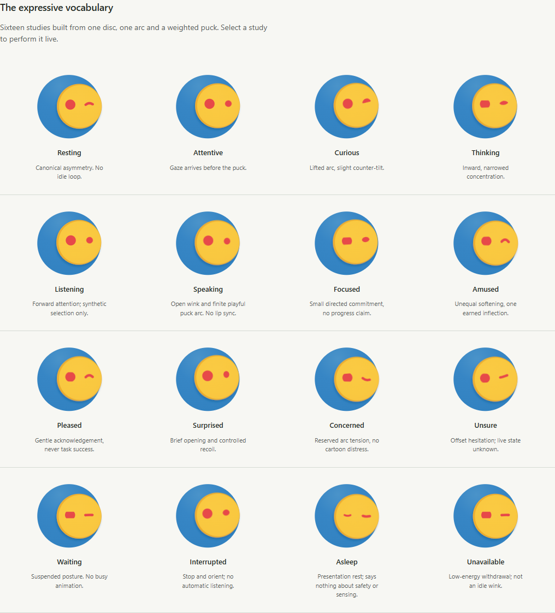
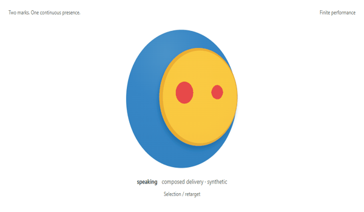
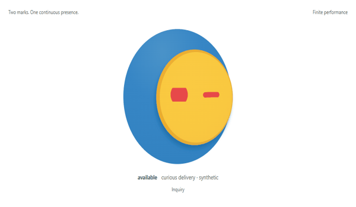

# OSCAR character — owner review packet

**Slice 11.1 + 11.2 / SIMULATED / OWNER VISUAL APPROVAL REQUIRED**

Start with the [running instructions](../../../design/expression-lab/README.md).
The lab is a design instrument with no Core, microphone, application, private-data
or credential connection. The immutable Orb remains the identity source.
11.3 and Slice 12 are not started. Gate C remains PARTIAL.

## Rationale and evaluation

- [Character brief and owner steering](BRIEF.md)
- [Reference research and prior A/B/C critique](RESEARCH.md)
- [Vocabulary, geometry, arbitration and accessibility](LANGUAGE.md)
- [Motion and ten complete transitions](MOTION.md)
- [Two substantive revision cycles](EVALUATION.md)
- [Independent review and scoped verdict](REVIEW.md)

## Actual browser evidence

All images come from the implemented lab. Frame strips/GIFs arrange browser
captures; none is generated art, real listening, Core work or device acceptance.
The 10fps GIFs are inspection previews; the lab itself stops instead of looping.

[Before / after across v0–v2](evidence/candidate-v2/iteration-comparison.png) shows
the ellipse-to-lid change and later opened eye/closed rest. For actual motion:

- [Surprise acquisition → recovery → stillness](evidence/candidate-v2/surprise-recovery.png)
- [Thinking → interrupted → attentive](evidence/candidate-v2/interruption-sequence.png)
- [Speaking frame sequence](evidence/candidate-v2/speaking-frames.png)
- [32/48/64/96/128/192px comparison](evidence/candidate-v2/small-scale-comparison.png)
- [Closed rest at three intensities](evidence/candidate-v2/closed-rest-intensity.png)
- [Reduced-motion equivalents](evidence/candidate-v2/reduced-motion.png)
- [Desktop](evidence/candidate-v2/desktop.png), [1280px](evidence/candidate-v2/desktop-1280.png), [390px lab](evidence/candidate-v2/mobile.png)
- [OS reduced motion / forced colors](evidence/candidate-v2/system-reduced-forced-colors.png)
- [Capture checks, compiled-artifact and image hashes](evidence/candidate-v2/receipt.json)

## Local evidence and limits

Node 24.19 LTS: TypeScript + production build passed; 20 component, geometry,
state/retarget/recovery and synthetic-isolation tests passed. Four existing
canonical-slice documentation tests passed. Repository/link/secret checks passed.
The capture harness exercised actual playback/pause, seek, conflicts, keyboard,
OS reduced motion, forced colors and 390/1280/1440px layouts with no external
requests or browser errors. The normalized neutral derivative/source comparison
is pixel-identical; source SHA-256 is unchanged.

These are local browser/prototype checks. The independent review scored four
original defects resolved but did not establish continuous naturalness or owner
acceptance. Small-size identity survives; sixteen independently readable tiny
emotions are not established. Mouthless speech is finite choreography, not audio
or lip sync. The companion screenshots were absent in this chat; their written
intent guided the work. Android/Tauri/physical/performance acceptance is not run.

## Owner decisions before 11.3

1. Does the smaller opened eye retain OSCAR's personality and unequal face?
2. Is the freer speaking/active puck travel playful enough, or too noticeable?
3. Do the serious lid and concern/hesitation marks convey the intended restraint?
4. Are the microreaction hold/recovery timings comfortable during repeated use?
5. Should mouthless speaking remain posture/cadence only?

No design preference is inferred from technical PASS or permission to experiment.
