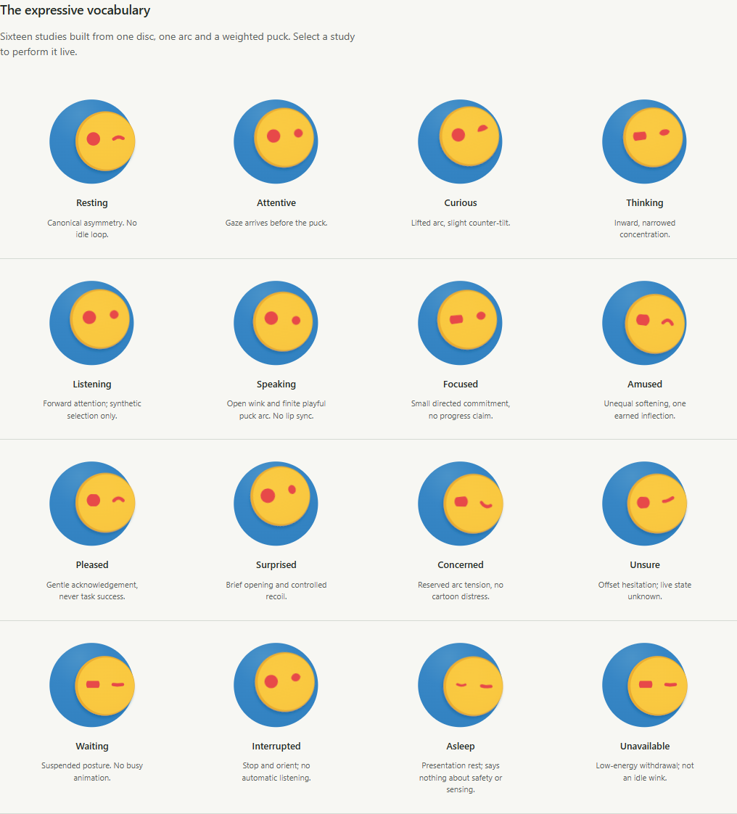
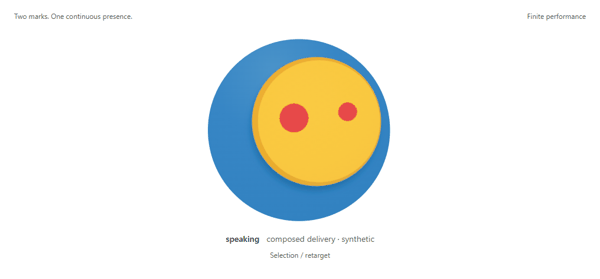

# OSCAR character — owner review packet

**Slice 11.1–11.3 / SYNTHETIC ENGINEERING CANDIDATE / CROSS-DEVICE OWNER REVIEW OUTSTANDING**

Start with the [running instructions](../../../design/expression-lab/README.md).
The lab is a design instrument with no Core, microphone, application, private-data
or credential connection. The immutable Orb remains the identity source.
V3 direction is owner-approved for engineering continuation. 11.3 extracts the
shared system; Slice 12 is not started. Gate C remains PARTIAL.

## Rationale and evaluation

- [Character brief and owner steering](BRIEF.md)
- [Reference research and prior A/B/C critique](RESEARCH.md)
- [Vocabulary, geometry, arbitration and accessibility](LANGUAGE.md)
- [Motion and ten complete transitions](MOTION.md)
- [Two substantive revision cycles](EVALUATION.md)
- [Independent review and scoped verdict](REVIEW.md)
- [Validation, draft PR and billing-blocked CI](VALIDATION.md)
- [Shared contract, event-driven engine and arbitration](ENGINE.md)
- [Later Desktop/Mobile integration boundary](INTEGRATION.md)

## Slice 11.3 native and React evidence

[React reference atlas](evidence/engine-v1/react-reference-atlas.png) and
[native Compose atlas](evidence/engine-v1/android-native-atlas.png) render the same
16 historical pose fixtures. The native capture is emulated, not physical.
[Permitted phrase accent](evidence/engine-v1/react-permitted-accent.png),
[new mute presentation](evidence/engine-v1/react-muted.png) and the
[browser receipt](evidence/engine-v1/react-receipt.json) verify the extracted renderer.
See the current [validation record](VALIDATION.md) for builds, native test limits
and CI truth. Historical v3 study evidence below remains unchanged.

## Actual browser evidence

All images come from the implemented lab. Frame strips/GIFs arrange browser
captures; none is generated art, real listening, Core work or device acceptance.
The 10fps GIFs are inspection previews; the lab itself stops instead of looping.

[Before / after across v0–v3](evidence/motion-v3/iteration-comparison.png) shows
the ellipse-to-lid change and later opened eye/closed rest. For actual motion:

The owner requested substantially broader movement after v2. V3 speech traverses
about **67px horizontally / 61px vertically** at the 340px stage; executing
traverses **62px / 41px**. Both are finite authored performances.
[Motion before/after](evidence/motion-v3/motion-before-after.png) preserves the
rejected subtle v2 study alongside the broader v3 trajectory.

- [Surprise acquisition → recovery → stillness](evidence/motion-v3/surprise-recovery.png)
- [Thinking → interrupted → attentive](evidence/motion-v3/interruption-sequence.png)
- [Speaking frame sequence](evidence/motion-v3/speaking-frames.png)
- [32/48/64/96/128/192px comparison](evidence/motion-v3/small-scale-comparison.png)
- [Closed rest at three intensities](evidence/motion-v3/closed-rest-intensity.png)
- [Reduced-motion equivalents](evidence/motion-v3/reduced-motion.png)
- [Desktop](evidence/motion-v3/desktop.png), [1280px](evidence/motion-v3/desktop-1280.png), [390px lab](evidence/motion-v3/mobile.png)
- [OS reduced motion / forced colors](evidence/motion-v3/system-reduced-forced-colors.png)
- [Capture checks, compiled-artifact and image hashes](evidence/motion-v3/receipt.json)

## Historical 11.1–11.2 local evidence and limits

Node 24.19 LTS: TypeScript + production build passed; 22 component, geometry,
state/retarget/recovery and synthetic-isolation tests passed. Four existing
canonical-slice documentation tests passed. Repository/link/secret checks passed.
The capture harness exercised actual playback/pause, seek, conflicts, keyboard,
OS reduced motion, forced colors and 390/1280/1440px layouts with no external
requests or browser errors. The normalized neutral derivative/source comparison
is pixel-identical; source SHA-256 is unchanged.

**LOCAL VALIDATION PASS / REMOTE CI NOT EXECUTED**: GitHub jobs were rejected
before steps ran due to account billing/spending limits; see [record](VALIDATION.md).
These are local browser/prototype checks. The independent review scored four
original defects resolved but did not establish continuous naturalness or owner
acceptance. Small-size identity survives; sixteen independently readable tiny
emotions are not established. Mouthless speech is finite choreography, not audio
or lip sync. The companion screenshots were absent in this chat; their written
intent guided the work. Android/Tauri/physical/performance acceptance is not run.

## Remaining owner quality decisions before UI adoption

1. Does the smaller opened eye retain OSCAR's personality and unequal face?
2. Is the freer speaking/active puck travel playful enough, or too noticeable?
3. Do the serious lid and concern/hesitation marks convey the intended restraint?
4. Are the microreaction hold/recovery timings comfortable during repeated use?
5. Should mouthless speaking remain posture/cadence only?

No design preference is inferred from technical PASS or permission to experiment.
