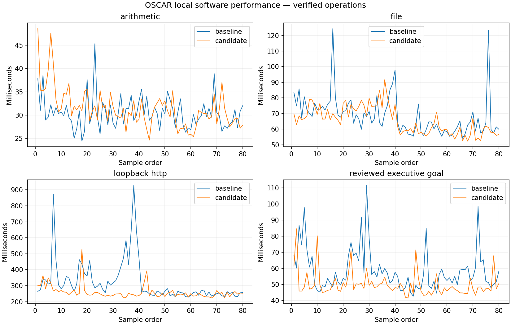

# Local performance acceptance

| Operation | Samples | Baseline p50 / p95 ms | Candidate p50 / p95 ms |
| --- | ---: | ---: | ---: |
| arithmetic | 80 | 30.1074 / 37.6321 | 30.7874 / 37.0219 |
| file | 80 | 64.986 / 85.785 | 64.8832 / 79.1328 |
| loopback_http | 80 | 266.974 / 583.8124 | 249.7148 / 321.1078 |
| reviewed_executive_goal | 80 | 54.8063 / 86.7544 | 47.6222 / 67.8011 |

Real disposable local SQLite/files/loopback; three warm-ups per operation. SQL trace enabled equally; no tracemalloc. Separate fresh processes, alternating revision order, authorized local Grid source with normal vs stopped background services. Cold samples are Harness startup/first task, not OS cold cache. RSS is Windows working set, not all-system memory/battery. Laptop cache/load and thermal state uncontrolled. Baseline extraction includes only runtime/config to reduce unrelated asset I/O. No model/provider/device performance claim.

Candidate source hashes in JSON identify the measured working tree. The candidate HEAD alone does not identify uncommitted source. No Internet, real account, device battery, room audio or sustained-use claim.
