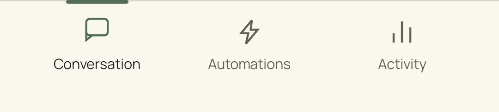

# Navigation and fluid motion — 2026-10-15

The bottom navigation stays full-width and attached to the bottom of the screen,
with a surface and top rule rather than a floating bar. One ink marker moves
between the actual tab positions. Its leading edge moves faster than its trailing
edge, briefly stretching the marker before both edges settle. A small icon lift
and animated text emphasis acknowledge selection. Rapid retaps retarget the
current spring movement. The existing three destinations and all routing remain
unchanged.

Activity's Active/Finished filters use the same moving-edge behavior. The selected
filter and its task content change immediately; animation does not retain the
previous task list or imply a change to task truth. Shared tactile sections and
supporting disclosures expand with a damped spring, and actionable feature rows
settle naturally after a press. These are local Compose animations with no new
dependencies. Page entry and the canonical expression engine are unchanged.

Both Android's animation preference and OSCAR's Reduce motion setting preserve
immediate selection and expansion without travel or icon lift. Marker placement
uses the measured tab positions, including enlarged text and right-to-left layout.
The controls retain native selected-tab semantics, keyboard activation and touch
targets of at least 48dp.

The [motion receipt](motion-review.json) records build/device checks and APK
hashes. Native frame captures use only the explicitly opted-in `.review` package
and disposable content. The animation preview is assembled from actual
phone-rendered frames stepped through Compose's test clock; it is not a
real-time performance recording.

Final verification: **31 native PASS / 4 intentional SKIP / 0 FAIL**, 134.660
seconds, plus a separate two-test motion check. Assembly, 23 app and five shared
expression JVM tests passed; lint has zero errors and 13 warnings. All 24 scoped
Python checks passed (a restricted pytest-cache write produced one warning).
The normal app is installed and foregrounded, and all three installed APK hashes
match their build artifacts. The temporary Core was stopped; the emulator stayed off.

The first complete run and its isolated expiry recheck lost an approval review
while waiting for expiry. A diagnostic recheck and the fresh complete final run
passed. The cause was not established; lifecycle/epoch diagnostics and the failed
results remain in the receipt. No signing, confirmation or Core code was changed,
and no assertion was weakened or approval reopened automatically.

[Normal navigation](motion/nav-motion-end.png) ·
[Enlarged RTL navigation](motion/nav-large-rtl.png) ·
[Activity filters](motion/activity-filter-settled.png).

Actual production-route captures: [Conversation](motion/app-conversation.png),
[Automations](motion/app-automations.png), [Activity](motion/app-activity.png).

`NavigationMotionTest` checks intermediate positions, transient stretching,
settling after interrupted travel, immediate reduced motion, full-width bottom
anchoring, enlarged RTL labels and immediate filtering without old task content.
The existing complete app suite checks actual production routing, duplicate
navigation, large text/IME, settings, privacy, approvals and Core loss/reconnect.

Final owner motion/visual acceptance remains pending. These checks do not establish
real audio, biometric or OEM capability acceptance; Gate C remains PARTIAL.
The emulator stays off under the owner's USB-phone substitution. No merge or
later backend work is included.
